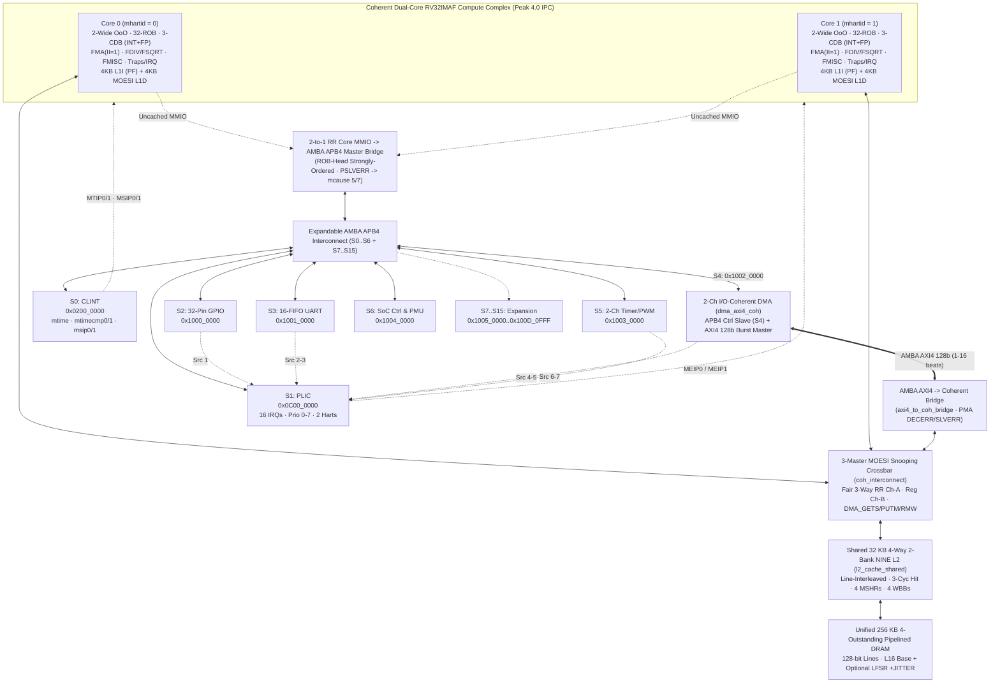

# Dual-Core 2-Wide Out-of-Order RISC-V SoC (`RV32IMAF_Zicsr_Zifencei`)

A synthesizable, formally verified **Dual-Core 2-Wide Superscalar Out-of-Order RISC-V System-on-Chip** (**peak 4.0 instructions/cycle chip throughput**) featuring full **IEEE-754-2008 `RV32F` non-blocking floating-point pipelines**, **precise M-mode exceptions & traps**, a **dual-tier AMBA AXI4 + expandable AMBA APB4 bus fabric**, a **3-master MOESI cache-coherent memory hierarchy** (`Core 0 + Core 1 + 2-Channel I/O-Coherent AXI4 DMA`), a **standard RISC-V Dual-Core PLIC + CLINT interrupt subsystem**, a **complete peripheral suite (GPIO, 16-FIFO 8N1 UART, 2-Ch Timer/PWM, SoC Control/PMU)**, and a **bare-metal C Hardware Abstraction Layer (`sw/hal/`)**.

### Standalone Architecture & Programmer Reference Manuals
- **[`docs/01_ISA_and_Core_Manual.md`](docs/01_ISA_and_Core_Manual.md)** — Full `RV32IMAF_Zicsr_Zifencei` ISA, M-Mode Privilege/Trap/CSR Reference, IEEE-754 FPU Architecture, and 2-Wide OoO Pipeline Microarchitecture.
- **[`docs/02_SoC_Memory_Map_and_Bus_Spec.md`](docs/02_SoC_Memory_Map_and_Bus_Spec.md)** — Unified 32-Bit Physical Address Map, PMA Rules, AMBA APB4 & AXI4 Protocols, 3-Master MOESI I/O-Coherence Transitions, and Guide to Adding Plug-and-Play Peripherals.
- **[`docs/03_Peripherals_and_HAL_Programmer_Guide.md`](docs/03_Peripherals_and_HAL_Programmer_Guide.md)** — Bit-by-Bit Register Maps for All 7 APB4 Peripherals, PLIC Interrupt Source Map, Bare-Metal C HAL API Reference, and Ready-to-Use C Examples.

---

## Highlights & Verified Headline Metrics

| Dimension | Verified Result |
| :--- | :--- |
| **ISA & Peak Width** | Full **`RV32IMAF_Zicsr_Zifencei`** (`RV32I` + `RV32M` + `RV32A` + 26 IEEE-754-2008 `RV32F` ops + `Zicsr` + `Zifencei` + M-mode traps/IRQs/`MRET`), **2 cores × 2-wide OoO = 4.0 peak chip IPC** |
| **IEEE-754 FPU (`RV32F`)** | 4-stage `II=1` single-rounding FMA + non-blocking iterative `FDIV.S`/`FSQRT.S` + 1-cycle `FMISC` + dedicated 3rd FP CDB (`cdb_fp`): **58,209** Verilator + **6,041** Icarus + **32,050** host `libm` vectors (**0 bit / `fflags` mismatches**); **`3.286` chip IPC (`1.82×` 2C speedup)** on `32×32` compiled GCC `-O2` float SGEMM |
| **Dual-Tier AMBA SoC Fabric** | **Tier 1 (AMBA AXI4 128-bit)**: 2-Channel 1D/2D unaligned-byte burst I/O-Coherent DMA (`dma_axi4_coh`) wired directly into the **3-Master MOESI Crossbar** (**zero manual cache flushes**, hardware LQ snoop-replay on DMA writes). **Tier 2 (AMBA APB4 32-bit)**: Expandable 7-to-16 slave fabric (`CLINT`, `PLIC`, `GPIO`, `UART`, `DMA`, `Timer/PWM`, `SoC Ctrl` + `S7..S15` plug-and-play slots; `PSLVERR` → precise `mcause=5/7`) |
| **Formal Proofs (SymbiYosys)** | **Unbounded ($t \to \infty$) `abc pdr` proofs** of BOTH **2-Master (`D0+D1`)** and **3-Master (`D0+D1+DMA_GETS/PUTM/RMW`)** MOESI SWMR, unique dirty owner, duplicate snoop tags & upgrade-ACK invariants + **Depth-14 `abc bmc3`** Golden Shadow Data-Value Consistency proofs (`rc=0`) |
| **RVWMO & Multicore Fuzz** | **10 / 10** RVWMO litmus & atomic mutex tests (**0** forbidden outcomes + negative ablation proving LQ snoop-replay fixes **`219/1,000 → 0/1,000`** `CoRR` violations); **200/200** `RV32IMA` + **150/150** 1C `RV32IMAF` + **100/100** 2C `RV32IMAF` coherence fuzz programs PASS (**0** SWMR/Shadow/RVWMO errors) |
| **Interrupts & Mixed Stress** | Real bare-metal C PLIC/CLINT ISRs with lazy FP context save (`trap.S`): warm **CLINT `MTIP` = `78` cyc**, **PLIC `MEIP` = `139` cyc**, **IPI RTT = `145` cyc**, **`< 1%`** idle `MIE=1` overhead; `S4` passes **144 simultaneous precise traps + 59 live IRQs + 768 DMA beats + 192 AMOs** under `+JITTER` (**0 errors**) |
| **Compiled C Scaling & Ablations** | **FP SGEMM (`32×32`)**: **`3.286` chip IPC (`1.82×`)** · **INT Benchmarks (`P1–P6`)**: up to **`3.341` chip IPC** (`P1`), **`3.205` chip IPC** (`P2`) & **`1.99×`** speedup (`P6`) · **Async Coherent DMA DSP (`S2`)**: **`1.06×`** faster streaming pipeline (`2.306` chip IPC, `2,048/2,048` AXI beats, `636` dirty C2C) · **MOESI vs. MESI**: **`−90.4%`** L2 traffic on `P3` |
| **Lint & Yosys Sign-Off** | **0 Verilator `-Wall` warnings**; **41 / 41** Yosys ABC unit synths + **3 / 3** full-chip flattened Tarjan **`scc -expect 0`** proofs (**0 latches, 0 comb loops**); Full 2C SoC = `1,015,040` cells (`89,805` FFs, `48 KB` SRAM; 3-master crossbar = `0.51%`, DMA = `2.19%`, APB4 fabric = `1.11%`) |

---

## System Architecture



---

## Comprehensive Verification & Benchmark Summary

### 1. Formal Proofs & Coherence Subsystem Stress (`make formal-phase3 formal-phase-u7 test-phase3-unit test-phase-u7`)
- **2-Master MOESI Formal Proof ([`tb/formal/coh_formal.sby`](tb/formal/coh_formal.sby)):** `abc pdr` unbounded SWMR (`PASS, rc=0`) + `abc bmc3` depth-14 Golden Shadow Data Consistency (`PASS, rc=0`).
- **3-Master Core0+Core1+DMA MOESI Formal Proof ([`tb/formal/coh_formal_dma.sby`](tb/formal/coh_formal_dma.sby)):** `abc pdr` unbounded 3-master SWMR & Unique Dirty Owner across `{D0, D1, WBB0/1, C2C0/1, DMA_WB, DMA_RMW}` (`PASS, rc=0`) + `abc bmc3` depth-14 exact data consistency covering `DMA_GETS`, `DMA_PUTM`, and partial-byte-preserving `DMA_RMW` (`PASS, rc=0`).
- **Standalone Stress (`tb_coh_subsystem` + `tb_dma_axi4_coh`):** `50,000` MOESI + `50,000` MESI + `5,000` Icarus dual-cache ops + `10,000` MOESI + `10,000` MESI + `2,000` Icarus concurrent 3-master AXI4 DMA ops (**0 protocol, SWMR, or Shadow errors**).

### 2. Apples-to-Apples 1-Core vs. 2-Core IPC & Scaling (`riscv64-unknown-elf-gcc -O2`, `L1:L2:DRAM = 1:4:16`)
Compiled bare-metal `RV32IMAF` (`make test-phase-u8`, `build/bench_soc_u8.json`) and `RV32IMA` (`make test-phase6-bench`, `build/bench_dual.json`) multi-threaded benchmarks running on `single_ooo2w_soc` (1C) vs. `dual_ooo2w_soc` (2C MOESI):

| Benchmark | ISA | 1C Cycles | 1C IPC | 2C Cycles | 2C Chip IPC | 2C Speedup | L2 Hit % | Dirty C2C | Bit-Exact `x14` |
| :--- | :---: | :---: | :---: | :---: | :---: | :---: | :---: | :---: | :---: |
| `S1_fp_sgemm_24x24` (`24×24` FP32) | `RV32IMAF` | 25,769 | 1.651 | 15,263 | **3.116** | **1.69×** | 48.3% | 273 | `0x5a5da97c` |
| `S1_fp_sgemm_32x32` (`32×32` FP32) | `RV32IMAF` | 55,182 | 1.654 | 30,355 | **3.286** | **1.82×** | 75.4% | 227 | `0x0e95feb7` |
| `P1_parallel_matmul` (`24×24` INT) | `RV32IMA` | 49,495 | 1.720 | 26,975 | **3.341** | **1.83×** | 45.5% | 279 | `0xbc159ac5` |
| `P2_parallel_stencil_mlp` (`16 KB`) | `RV32IMA` | 74,651 | 1.674 | 44,227 | **3.205** | **1.69×** | 88.0% | 145 | `0x5103d83c` |
| `P3_prod_cons_ring` (`256×16 B`) | `RV32IMA` | 8,990 | 1.085 | 8,469 | 1.635 | 1.06× | 15.3% | 679 | `0x22e9e713` |
| `P4_parallel_hist_amo` (`2,048`) | `RV32IMA` | 33,589 | 1.542 | 17,098 | **2.871** | **1.96×** | 23.9% | 173 | `0x5c11e45f` |
| `P5_padded_counters` (`16 B`-aligned) | `RV32IMA` | 12,267 | 0.818 | 6,283 | 1.609 | **1.95×** | 32.0% | 9 | `0x5a58574a` |
| `P5_false_shared` (same `16 B` line) | `RV32IMA` | 12,247 | 0.820 | 9,319 | 1.087 | 1.31× | 33.3% | 2,008 | `0x5a58574a` |
| `P6_parallel_crc_fsm` (`64` pkts) | `RV32IMA` | 151,077 | 1.014 | 76,073 | 2.023 | **1.99×** | 18.8% | 23 | `0xe161b556` |

### 3. Full-SoC `RV32IMAF` DMA, Interrupt & Mixed-Trap Benchmarks (`make test-phase-u8`, `build/bench_soc_u8.json`)

| Benchmark | 2C Cycles | 2C Chip IPC | Measured SoC Non-Blocking & Hardware Metrics | Bit-Exact / Status |
| :--- | :---: | :---: | :--- | :---: |
| **`S2_dma_double_buf_fp_dsp`** | 89,251 (`44,164` pipe) | **2.306** | CPU-Copy: `47,010` pipe cyc (`2.224` IPC) → **Async Coherent DMA**: **`1.06×` faster streaming pipeline**, `2,048` R / `2,048` W AXI beats, `636` dirty C2C (0 flushes), `8+8` PLIC ISRs | `0x9ada2f2b` PASS |
| **`S3_irq_latency_gpio_uart`** | 25,457 | **1.875** | `MIE=0` `1,786` cyc (`1.698` IPC) vs. `MIE=1` idle `1,803` cyc (`1.682` IPC, **`+0.95%`**); warm **CLINT `MTIP` = `78` cyc**, **PLIC `MEIP` = `139` cyc**, **IPI RTT = `145` cyc**, 3 GPIO + 4 Timer0 ISRs | `0x00083386` PASS |
| **`S4_trap_stress_mixed`** | 35,077 | **1.806** | Simultaneous **144 precise traps** (`mcause=2,4,5,6,7,11`) + 16 CLINT + 16 PLIC Timer0 + 3 GPIO + 12+12 DMA IRQs + 192 `AMOADD.W` + 384/384 DMA beats + 697 C2C under `+JITTER` | `0x000840cc` PASS |

### 4. Quantitative Architectural Ablations (`make test-phase6-bench`, `build/bench_dual.json`)

| Ablation Experiment | Baseline | Upgraded | Verified Measured Impact |
| :--- | :--- | :--- | :--- |
| **False Sharing vs. 16 B Padding (`P5`)** | Packed same 16 B line (`9,319` cyc, `2,008` C2C) | 16 B-padded lines (`6,283` cyc, `9` C2C) | **`1.48×` speedup**, **`−99.6%` C2C ping-pongs** (`1.31× → 1.95×` vs. 1C) |
| **MOESI (`M→O`) vs. MESI (`M→S+WB`)** | MESI (`ENABLE_MOESI_O=0`) | MOESI (`ENABLE_MOESI_O=1`) | **`−90.4%` L2 traffic on `P3`** (`749 → 72` ops, `677` WBs saved), **`−20.2%` on `P1`**, **`1,145` sharing WBs eliminated** across suite |
| **Shared 32 KB 2-Bank L2 Cache** | 1C No-L2 (`L16` DRAM) | 1C+L2 / 2C+L2 | **`−81.1%` DRAM reads on `P2`** (`5,678 → 1,072`), **`1.44×`** 1C L2 gain (`1.166 → 1.674` IPC), **`2.42×`** (`P2`) & **`2.39×`** (`P4`) combined 2C+L2 gain |
| **L1I Next-Line Prefetcher (2C)** | Prefetcher OFF (`ENABLE_PREFETCH=0`) | Prefetcher ON (`ENABLE_PREFETCH=1`) | **`−43.8%` to `−56.2%` L1I misses** across all 7 variants (`P6`: `155 → 73`, **−52.9%**; `P2`: `128 → 56`, **−56.2%**) |

### 5. Yosys Gate-Level Synthesis & Flattened Zero-Loop Audit (`make synth-phase7`, `build/synth_audit.json`)

| Subsystem / Module | ABC Std Cells | Comb Gates | Flip-Flops | Latches | Comb Loops |
| :--- | :---: | :---: | :---: | :---: | :---: |
| **`ooo2w_core`** (all 26 `RV32IMAF` units) | **411,042** | 380,776 | **30,266** | **0** | **0** (`scc -expect 0`) |
| Private L1s (`icache_2w` + `dcache_nb_coh`, 8s synth; 8 KB/core arch) | 49,588 | 43,539 | 6,049 | **0** | **0** |
| **3-Master MOESI Crossbar (`coh_interconnect`)** | **5,205** | 4,240 | **965** | **0** | **0** |
| **Coherent AXI4 DMA + Bridge (`dma_axi4_coh` + `axi4_to_coh_bridge`)** | **22,241** | 18,772 | **3,469** | **0** | **0** |
| **AMBA APB4 Fabric + 6 Peripherals (`CLINT/PLIC/GPIO/UART/Timer/Ctrl`)** | **11,239** | 9,638 | **1,601** | **0** | **0** |
| Shared 32 KB 2-Bank L2 (`l2_cache_shared`, 8s/bank synth) | 55,095 | 43,955 | 11,140 | **0** | **0** |
| **1-Core SoC Rollup (`single_ooo2w_soc`, 40 KB SRAM)** | **517,922** | 469,066 | **48,856** | **0** | **0** (`scc -expect 0`) |
| **Dual-Core SoC Rollup (`dual_ooo2w_soc`, 48 KB SRAM)** | **1,015,040** | 925,235 | **89,805** | **0** | **0** (`scc -expect 0`) |

---

## Repository Layout

```text
Dual-Core-Out-of-Order-RISCV-Core/
├── Makefile                        # Full lint, Yosys synth/SCC, formal, unit, fuzz, SoC & benchmark flow
├── docs/                           # Standalone Architecture, Bus & HAL Reference Manuals
│   ├── 01_ISA_and_Core_Manual.md
│   ├── 02_SoC_Memory_Map_and_Bus_Spec.md
│   └── 03_Peripherals_and_HAL_Programmer_Guide.md
├── rtl/
│   ├── common/                     # rv32ima_defs.vh, decoder.sv, alu.v, branch_comp.v, imm_gen.v, mul_unit.sv, div_unit.sv
│   ├── fpu/                        # fpu_defs.vh, fpu_fma_pipe.sv, fpu_div_sqrt.sv, fpu_misc.sv
│   ├── core/                       # ooo2w_core.sv, fetch2w.sv, btb_bht2w.sv, rat2w.sv, frat2w.sv, rob2w.sv,
│   │                               # rs_cluster2w.sv, rs_fpu2w.sv, lsq2w.sv, cdb_arbiter2w.sv, regfile2w.sv, fregfile2w.sv, csr_unit.sv
│   ├── mem/                        # icache_2w.sv, dcache_nb.sv, l2_bank.sv, l2_cache_shared.sv, main_memory_dram.sv
│   ├── coherence/                  # coh_defs.vh, dcache_nb_coh.sv, coh_interconnect.sv (3-master MOESI w/ DMA)
│   ├── bus/                        # apb4_interconnect.sv, mmio_to_apb4_bridge.sv, axi4_to_coh_bridge.sv
│   ├── periph/                     # apb4_clint.sv, apb4_plic.sv, apb4_gpio.sv, apb4_uart.sv,
│   │                               # apb4_timer_pwm.sv, apb4_soc_ctrl.sv, dma_axi4_coh.sv
│   └── soc/                        # soc_addr_map.vh, single_ooo2w_soc.sv, dual_ooo2w_soc.sv
├── sw/
│   ├── common/                     # crt0.S, trap.S (Direct/Vectored + lazy FP save), link.ld, sync.h
│   ├── hal/                        # soc_regs.h, hal_irq.{h,c}, hal_clint.h, hal_plic.h, hal_gpio.h,
│   │                               # hal_uart.{h,c}, hal_dma.h, hal_timer.h
│   ├── c_bench/                    # Phase 6 parallel RV32IMA benchmarks (P1..P6)
│   └── c_soc/                      # Phase U3..U8 ISR, peripheral, RV32IMAF, coherent DMA & flagship benchmarks (S1..S4)
├── tb/
│   ├── common/                     # ooo_trace_mon2w.sv, rv32im_iss.sv
│   ├── unit/                       # Core, L1/L2, MOESI, APB4, PLIC, GPIO/UART/Timer, IEEE-754 FPU & AXI4 DMA unit TBs
│   ├── formal/                     # coh_formal.sby (2-master) + coh_formal_dma.sby (3-master Core0+Core1+DMA)
│   └── soc/                        # tb_ooo2w_soc, tb_single_ooo2w_p1_soc, tb_single_ooo2w_soc, tb_dual_ooo2w_soc
└── scripts/                        # rv32ima_asm.py, ieee754_oracle.py, dual_core_checker.py, fuzz_dual_core.py,
                                    # test_litmus_rvwmo.py, test_phase_u1..u7, run_dual_benchmarks.py, run_soc_benchmarks.py, synth_audit.py
```

---

## Quick Start & Reproducible Verification

Requires `verilator`, `iverilog`/`vvp`, `yosys`, `yowasp-sby` + `yosys-abc`, `python3`, and `riscv64-unknown-elf-gcc` (configure tool paths at the top of `Makefile` if installed outside the default prefix).

```bash
# Run the complete clean end-to-end lint, formal proof, unit, fuzz, SoC, benchmark & synthesis suite:
make clean all

# Or run individual verification gates:
make formal-phase3 formal-phase-u7         # SymbiYosys 2-master & 3-master unbounded PDR + BMC proofs
make test-phase-u1 test-phase-u2           # Precise M-mode traps, AMBA APB4 fabric & access faults
make test-phase-u3 test-phase-u4           # Dual-core PLIC ISRs, GPIO, 8N1 UART, Timer/PWM & C HAL
make test-phase-u5 test-phase-u6           # 96k-vector IEEE-754 FPU & 250-prog RV32IMAF fuzz + SGEMM
make test-phase-u7 test-phase-u8           # Coherent AXI4 DMA proof & flagship S1..S4 full-SoC benchmarks
make test-phase4-litmus test-phase5-fuzz   # 10 RVWMO litmus tests + 200-program dual-core fuzzer
make test-phase6-bench synth-phase7        # 1C vs 2C ablations + 41-unit Yosys ABC & flattened SCC audit
```
