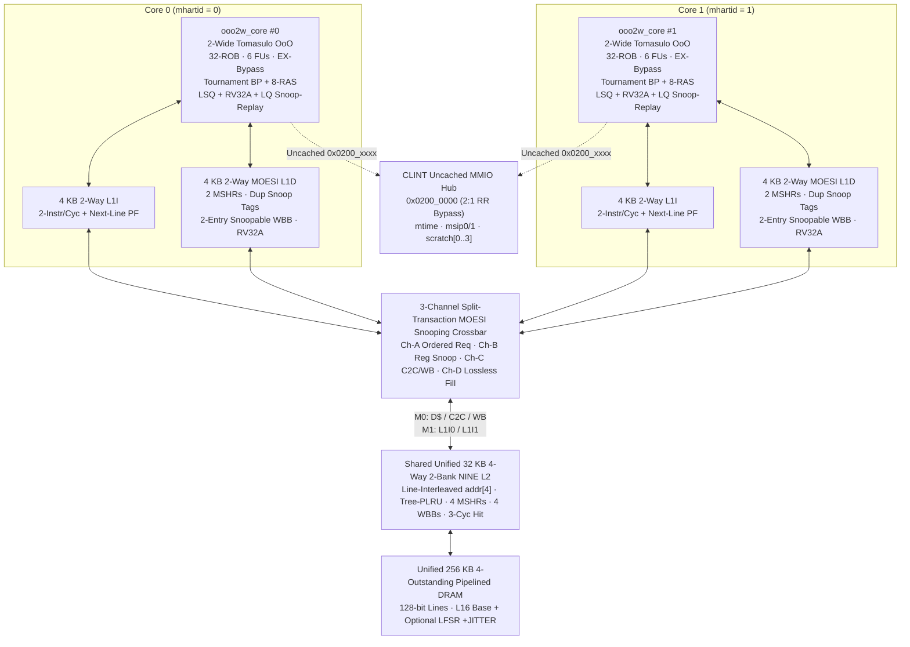

# Dual-Core 2-Wide Superscalar Out-of-Order RISC-V Processor (`RV32IMA_Zicsr_Zifencei`)

A synthesizable **Dual-Core 2-Wide Superscalar Out-of-Order RISC-V SoC** (**peak 4.0 instructions/cycle chip throughput**) featuring a **3-level MOESI cache-coherent memory hierarchy**, **RVWMO speculative Load-Queue snoop-invalidation replay**, **unbounded formal SWMR verification via SymbiYosys PDR**, a **10-test RVWMO litmus & atomic synchronization suite with negative ablation proof**, a **200-program dual-core RVFI + global bus linearizability fuzzer**, and a **bare-metal `riscv64-unknown-elf-gcc -O2` multi-threaded C benchmark & ablation suite**.

---

## Highlights & Verified Headline Metrics

| Dimension | Verified Result |
| :--- | :--- |
| **ISA & Peak Width** | Full **`RV32IMA_Zicsr_Zifencei`** (`RV32I` + `RV32M` + `LR.W`/`SC.W` + 9× `AMO*.W` + `FENCE`/`FENCE.I` + `Zicsr`), **2 cores × 2-wide OoO = 4.0 peak chip IPC** |
| **Cache Hierarchy** | Private **4 KB 2-way L1I** (next-line prefetcher) + **4 KB 2-way Non-Blocking MOESI L1D** (2 MSHRs, dup snoop tags, 2-entry snoopable WBB) → **3-Ch Split-Tx MOESI Crossbar** → **32 KB 4-Way 2-Bank NINE L2** → **256 KB 4-Outstanding Pipelined DRAM (`L16`)** + **CLINT MMIO** |
| **Formal Proof (SymbiYosys)** | **Unbounded ($t \to \infty$) `abc pdr` proof** of all 29 SWMR / unique-owner / duplicate-tag / upgrade-ACK invariants + **Depth-14 `abc bmc3` proof** of exact 128-bit Golden Shadow Data-Value consistency |
| **RVWMO Memory Consistency** | **10 / 10** canonical litmus & contended mutex tests PASS (**9,000** litmus rounds + **3,000** atomics, **0** forbidden outcomes, **0** SWMR/Shadow errors) + **negative ablation** proving disabling LQ snoop-replay triggers **`219 / 1,000` `L05_CoRR` violations → `0 / 1,000`** with hardware replay ON |
| **Multicore Linearizability Fuzz** | **200 / 200** randomized dual-core stress programs PASS (**57,257** committed instrs, **4,342** dirty C2C xfers, **3,886** `AMO*.W`, **2,144** `LR/SC`, **0** RVWMO/SWMR/watchdog errors) + **6/6** injected bugs caught by `dual_core_checker --self-test` |
| **Compiled C (`-O2`) Scaling** | Up to **`3.021` aggregate chip IPC** (`P2` stencil), **`2.949` chip IPC** (`P1` matmul), and **`1.99×` 2C speedup** (`P6` CRC+FSM), **`1.96×`** (`P4` AMO histogram), **`1.95×`** (`P5` padded counters) — 100% bit-exact `x14` across 1C & 2C |
| **Architectural Ablations** | **MOESI vs. MESI**: **`−90.4%`** L2 traffic on `P3` ring (`677` dirty WBs eliminated; `−35.5%` on 50k unit stress) · **Shared L2**: **`−81.1%`** DRAM reads on `P2` · **L1I Prefetcher**: **`−43.8%` to `−57.9%`** L1I misses · **16 B Padding vs. False Sharing**: **`−99.6%`** C2C & **`1.48×`** faster |
| **Lint & Yosys Sign-Off** | **0 Verilator `-Wall` warnings**, **0 inferred latches**, **0 combinational loops** proven via flattened Tarjan **`scc -expect 0`** across full `dual_ooo2w_soc`; MOESI crossbar = **`0.26%`** of chip logic cells |

---

## System Architecture



### Key Microarchitectural Engineering Features
1. **2-Wide Superscalar Out-of-Order Core (`ooo2w_core.sv`)**:
   - Unified `RV32IMA_Zicsr_Zifencei` decode, 2-wide register renaming with 4-checkpoint branch recovery (`rat2w.sv`), 32-entry 2-wide ROB (`rob2w.sv`), 4 partitioned Reservation Stations (`8×ALU`, `4×MUL`, `2×DIV`, `4×BR`) with single-cycle `EX→EX` wakeup/bypass, 6 parallel functional units (`2×ALU`, 3-stage pipelined `MUL`, Radix-4 early-out `DIV`, `BR`, `LSU+AMO`), and 2-wide CDB (`cdb_arbiter2w.sv`).
   - Tournament Branch Predictor (GShare + Bimodal + Chooser) + 64-entry BTB + 8-entry Return Address Stack (`btb_bht2w.sv`).
   - Load-Store Queue (`lsq2w.sv`, 8 LQ + 8 SQ) with conservative disambiguation, 1-cycle Store-to-Load Forwarding (STLF), ROB-head non-speculative `LR.W`/`SC.W`/9× `AMO*.W`, `FENCE`/`FENCE.I` barrier gating, and **RVWMO Speculative Load Snoop-Invalidation Replay** (with ROB-head forward-progress exemption preventing false-sharing livelock).
2. **MOESI Non-Blocking L1D (`dcache_nb_coh.sv`) & 3-Channel Split-Transaction Crossbar (`coh_interconnect.sv`)**:
   - Full 5-state **MOESI** (`M, O, E, S, I`) with toggleable `ENABLE_MOESI_O=1/0` ablation hook (MOESI `M→O` direct dirty cache-to-cache sharing with zero L2 writeback vs. MESI `M→S` forced L2 writeback).
   - **Duplicate Snoop Tag/State Array** eliminates CPU–snoop tag-port structural hazards on non-colliding sets.
   - Explicit transient MSHR race handling: `SM_AD`/`OM_AD` pending `Upgrade` that loses Channel A arbitration to a peer's `GetM` services the snoop (`S→I` or `O→I` + dirty C2C supply) and promotes cleanly to `IM_AD` (`GetM`).
   - **Snoopable 2-Entry WBB**: supplies dirty C2C data directly from evicted lines in flight and cancels stale WBB writebacks if invalidated by a peer `GetM`/`Upgrade`.
   - Separate **Channel A** (ordered request/address-hazard table), **Channel B** (registered snoop broadcast), **Channel C** (snoop response / C2C / WBB), and **Channel D** (lossless data return) eliminate request–snoop cyclic deadlock by construction.
3. **Shared 32 KB 2-Bank Non-Inclusive L2 (`l2_cache_shared.sv`) & Pipelined DRAM (`main_memory_dram.sv`)**:
   - Line-interleaved (`addr[4]`) across two independent 4-way Tree-PLRU banks (2 MSHRs + 2 WBBs per bank = 4 total) serving L1D coherence traffic (`M0`) and L1I instruction fetches (`M1`) concurrently.
   - Non-Inclusive (NINE) policy eliminates inclusive back-invalidation deadlocks; uniform 16-byte (128-bit) lines end-to-end.

---

## Six-Pillar Verification Results

### Pillar 1 — Formal Protocol Verification (SymbiYosys `yowasp-sby` + `yosys-abc`)
Reduced-geometry 2-core MOESI (`2 sets × 2 ways`, 4 active cache lines including tag aliasing, full `dcache_nb_coh × 2 + coh_interconnect + L2`) formally proved in [`tb/formal/coh_formal.sby`](tb/formal/coh_formal.sby):

| Formal Task | Engine & Depth | Scope Proved | Runtime | Status |
| :--- | :--- | :--- | :---: | :---: |
| `pdr_swmr` | **`abc pdr` (Unbounded $t \to \infty$)** | All **29 SWMR**, unique-owner (`M`/`O`), exclusive (`E`), duplicate-tag equivalence, and upgrade-ACK invariants across all reachable transient MSHR/WBB interleavings | 169.1 s | **PASS (`rc=0`)** |
| `bmc_full` | **`abc bmc3` (Depth 14)** | Exact **Golden Shadow Data-Value Consistency** + SWMR across `D0`, `D1`, `WBB0`, `WBB1`, in-transit `C2C` buffers, and clean `L2` | 29.3 s | **PASS (`rc=0`)** |

### Pillar 2 — Unit & Coherence Subsystem Stress (Verilator `--assert` + Icarus Verilog)
- **Standalone Coherence Stress (`tb_coh_subsystem.sv` + always-on `coh_checker.sv`)**:
  - **MOESI (`ENABLE_MOESI_O=1`)**: **50,000** adversarial ops (`11,095` dirty C2C, `62` upgrade-race promotions, `5,824` L2 WBs) — **0 errors** (Verilator) + **5,000** ops — **0 errors** (Icarus Verilog).
  - **MESI (`ENABLE_MOESI_O=0`)**: **50,000** adversarial ops (`9,031` L2 WBs — **MOESI cuts L2 writebacks by 35.5%**) — **0 errors**.
- **Core & Memory Unit Testbenches** (Verilator + Icarus Verilog): `tb_decoder`, `tb_csr_unit`, `tb_rs_cluster2w`, `tb_btb_bht2w`, `tb_dcache_nb`, `tb_icache_2w` (14/14), `tb_lsq2w_replay`, `tb_clint_mmio` (7/7), `tb_l2_cache_shared` (5,000 dual-master ops, 0 errors), and 120/120 single-core RV32IMA differential fuzz (bit-exact vs. `RV32IMA_ISS`).

### Pillar 3 — RVWMO Memory Consistency Litmus Suite & Negative Ablation (`make test-phase4-litmus`)
All 10 canonical litmus & atomic synchronization tests executed on live `dual_ooo2w_soc` with `+JITTER` DRAM latency jitter and always-on `coh_checker` (**0 SWMR errors, 0 Golden Shadow data errors, 0 hang watchdogs**):

| Test | Workload | Forbidden | Observed Outcome Histogram / Counts | LQ Replays (C0/C1) | Dirty C2C | Cycles |
| :--- | :--- | :---: | :--- | :---: | :---: | :---: |
| `L01_MP` | Message Passing (`FENCE`) × 1,000 | **0** | `[920, 79, 0, 1]` | `1001 / 1001` | 7,005 | 110,406 |
| `L02_MP_aqrl` | Message Passing (`.rl`/`.aq` AMOs) × 1,000 | **0** | `[817, 146, 0, 37]` | `1075 / 1001` | 8,004 | 114,127 |
| `L03_SB` | Store Buffering (`FENCE`) × 1,000 | **0** | `[0, 11, 903, 86]` | `1007 / 1001` | 8,004 | 117,181 |
| `L04_LB` | Load Buffering (`FENCE`) × 1,000 | **0** | `[206, 1, 793, 0]` | `1002 / 1001` | 8,005 | 112,066 |
| `L05_CoRR` | Same-Addr Read-Read (no fence, OoO spec load) × 1,000 | **0** | `[598, 106, 0, 296]` | `1620 / 1402` | 6,406 | 128,968 |
| `L06_CoWR` | Same-Addr Write-Read (no fence) × 1,000 | **0** | `[0, 1000, 0, 0]` | `1001 / 1001` | 5,004 | 98,726 |
| `L07_CoWW` | Same-Addr Write-Write (no fence, OoO observer) × 1,000 | **0** | `[892, 108, 0, 0]` | `1582 / 1358` | 6,362 | 128,529 |
| `L08_R_MCA` | Multi-Copy Atomicity `R` (`FENCE`) × 1,000 | **0** | `[904, 90, 0, 6]` | `1002 / 1001` | 8,004 | 111,937 |
| `L09_2plus2W` | `2+2W` (`FENCE`) × 1,000 | **0** | `[0, 840, 17, 143]` | `1002 / 1001` | 7,004 | 106,461 |
| `L10_Atomic_Mutex` | 1k `AMOSWAP` spinlock + 1k `LR/SC` CAS + 1k `AMOADD` | **0** | `spin=1000, cas=1000, amo=1000` (`amo_hw=2508/3000`) | — | 1,533 | 33,397 |
| `CLINT_Dual_MMIO` | Concurrent 2C `MSIP`/`MTIME`/`SCRATCH` + `+LOG` | **0** | `c0_x14=0x11223345`, `c1_x14=0x55667789`, `478` RVFI commits | — | — | 568 |

**Negative Ablation Proof (`L05_CoRR`, Speculative Load-Queue Snoop-Replay OFF vs. ON):**
- `ENABLE_SNOOP_REPLAY = 0`: **`219 / 1,000` CoRR violations reproduced** (`hist = [780, 0, 219, 1]`, `replay = 0/0`).
- `ENABLE_SNOOP_REPLAY = 1`: **`0 / 1,000` violations** (`hist = [598, 106, 0, 296]`, **`1,402` hardware LQ snoop-replays** on Core 1).

### Pillar 4 & 5 — 200-Program Dual-Core RVFI + Global Bus Linearizability Fuzzer (`make test-phase5-fuzz`)
Every fuzz program runs on `Vdual_soc` with `+JITTER`, always-on `coh_checker`, and full 4-wide RVFI + Channel A `+LOG` audited end-to-end by [`scripts/dual_core_checker.py`](scripts/dual_core_checker.py) (whose `--self-test` confirms **6/6** injected bug classes caught):

| Category | Description | Result |
| :--- | :--- | :---: |
| `C1_disjoint_rvfi` | Disjoint data-parallel RV32IMA/CSR/AMO (bit-exact dual ISS + linearizability) | **30 / 30 PASS** |
| `C2_shared_false_share` | 4-line hot-spot false sharing, sub-word `SB/SH/LB/LH`, `DIV` + speculative loads | **50 / 50 PASS** |
| `C3_contended_atomics` | All 9 `AMO*.W`, bounded `LR/SC` CAS loops, same-line `AMOSWAP` spinlocks | **50 / 50 PASS** |
| `C4_set_evict_wbb` | 6 tag-aliased lines (`0x800` stride) forcing L1D dirty evictions & WBB C2C | **40 / 40 PASS** |
| `C5_fencei_clint_ras` | `FENCE`, `FENCE.I` clean-all sweeps, `JAL`/`JALR` RAS calls, CLINT MMIO | **30 / 30 PASS** |
| **Total** | **57,257 commits · 214,699 cyc · 9,314 loads · 5,185 stores (186 coalesced) · 3,886 AMOs · 2,144 LR/SC · 4,342 dirty C2C** | **200 / 200 PASS** |

> **Real Silicon Bug Caught by Fuzzer (`lsq2w.sv`)**: Category `C3_contended_atomics` uncovered a textbook OoO false-sharing livelock where a lock holder's non-speculative load at ROB head (`[0x20004]`) was repeatedly snoop-replayed every ~9 cycles by a peer's tight `AMOSWAP.W` spinlock (`[0x20000]`) on the same 16-byte cache line. Exempting unpoisoned ROB-head loads from new snoop poisoning (`lq_rob_tag[sni] != rob_head`, while preserving sticky `lq_replay` for loads poisoned while speculative) eliminated the livelock completely (at most 1 replay per load) while retaining 100% RVWMO/CoRR protection.

---

## Pillar 6 — Performance Scaling, Ablations & Yosys Synthesis Area Breakdown

### 1. Apples-to-Apples 1-Core vs. 2-Core Scaling (`riscv64-unknown-elf-gcc -march=rv32ima -O2`, `L1:L2:DRAM = 1:4:16`)

| Benchmark | 1C Cycles | 1C IPC | 2C Cycles | 2C Chip IPC | 2C Speedup | L2 Hit % | Dirty C2C | Bit-Exact `x14` |
| :--- | :---: | :---: | :---: | :---: | :---: | :---: | :---: | :---: |
| `P1_parallel_matmul` (`24×24`) | 56,729 | 1.501 | 30,537 | **2.949** | **1.86×** | 45.5% | 279 | `0xbc159ac5` |
| `P2_parallel_stencil_mlp` (`16 KB`) | 82,811 | 1.509 | 47,220 | **3.021** | **1.75×** | 88.0% | 148 | `0x5103d83c` |
| `P3_prod_cons_ring` (`256×16 B`) | 8,990 | 1.085 | 8,469 | 1.635 | 1.06× | 15.3% | 679 | `0x22e9e713` |
| `P4_parallel_hist_amo` (`2,048`) | 33,590 | 1.542 | 17,102 | **2.870** | **1.96×** | 23.9% | 173 | `0x5c11e45f` |
| `P5_padded_counters` (`16 B`-aligned) | 12,267 | 0.818 | 6,283 | 1.609 | **1.95×** | 32.0% | 9 | `0x5a58574a` |
| `P5_false_shared` (same `16 B` line) | 12,247 | 0.820 | 9,319 | 1.087 | 1.31× | 33.3% | 2,008 | `0x5a58574a` |
| `P6_parallel_crc_fsm` (`64` pkts) | 151,248 | 1.013 | 76,176 | 2.021 | **1.99×** | 18.2% | 23 | `0xe161b556` |

### 2. Quantitative Architectural Ablations (`make test-phase6-bench`, exported to `build/bench_dual.json`)

| Ablation Experiment | Baseline | Upgraded | Verified Measured Impact |
| :--- | :--- | :--- | :--- |
| **False Sharing vs. 16 B Padding (`P5`)** | Packed same 16 B line (`9,319` cyc, `2,008` C2C) | 16 B-padded lines (`6,283` cyc, `9` C2C) | **`1.48×` speedup**, **`−99.6%` C2C ping-pongs** (`1.31× → 1.95×` vs. 1C) |
| **MOESI (`M→O`) vs. MESI (`M→S+WB`)** | MESI (`ENABLE_MOESI_O=0`) | MOESI (`ENABLE_MOESI_O=1`) | **`−90.4%` L2 traffic on `P3`** (`749 → 72` ops, `677` WBs saved), **`−20.3%` on `P1`**, **`1,147` sharing WBs eliminated** across suite |
| **Shared 32 KB 2-Bank L2 Cache** | 1C No-L2 (`L16` DRAM) | 1C+L2 / 2C+L2 | **`−81.1%` DRAM reads on `P2`** (`5,676 → 1,071`), **`1.32×`** 1C L2 gain, **`2.31×`** (`P2`) & **`2.39×`** (`P4`) combined 2C+L2 gain |
| **L1I Next-Line Prefetcher (2C)** | Prefetcher OFF (`ENABLE_PREFETCH=0`) | Prefetcher ON (`ENABLE_PREFETCH=1`) | **`−43.8%` to `−57.9%` L1I misses** across all 7 variants (`P6`: `155 → 73`, **−52.9%**; `P2`: `126 → 53`, **−57.9%**) |

### 3. Yosys Gate-Level Synthesis Area/FF Breakdown & Zero-Loop Audit (`make synth-phase7`)
Synthesized with Yosys (`synth -noshare` + ABC standard-cell mapping + `check -assert` + `ltp -noff`; cache arrays modeled at 8 sets/bank for control/tag/MSHR logic synthesis alongside full architectural SRAM capacities) plus full-chip flattened Tarjan **`scc -expect 0`**:

| Subsystem / Module | ABC Std Cells | Comb Gates | Flip-Flops | Latches | Comb Loops | ABC LTP Depth |
| :--- | :---: | :---: | :---: | :---: | :---: | :---: |
| **`ooo2w_core`** (18 units, full geometry) | **288,461** | 265,213 | **23,248** | **0** | **0** | 180 (`lsq2w`) / 179 (`rob2w`) |
| `icache_2w` (2-way L1I + PF, 8s synth; 4 KB arch) | 13,637 | 11,173 | 2,464 | **0** | **0** | 25 |
| `dcache_nb` (1C L1D, 8s synth; 4 KB arch) | 26,909 | 23,524 | 3,385 | **0** | **0** | 88 |
| `dcache_nb_coh` (2C MOESI L1D + DupTag + 2-WBB, 8s) | 35,919 | 32,334 | 3,585 | **0** | **0** | 97 |
| **`coh_interconnect`** (3-Ch Split-Tx MOESI Crossbar) | **1,927** | 1,530 | **397** | **0** | **0** | **14** |
| `l2_cache_shared` (2-Bank 4-Way NINE L2, 8s/b; 32 KB arch) | 55,095 | 43,955 | 11,140 | **0** | **0** | 34 |
| `clint_mmio` (Uncached CLINT MMIO Hub) | 982 | 748 | 234 | **0** | **0** | 22 |
| **1-Core SoC Rollup (`single_ooo2w_soc`)** | **385,084** | 344,613 | **40,471** | **0** | **0** (`scc -expect 0`) | 40 KB on-chip SRAM |
| **Dual-Core SoC Rollup (`dual_ooo2w_soc`)** | **734,038** | 663,673 | **70,365** | **0** | **0** (`scc -expect 0`) | 48 KB on-chip SRAM |
| **2-Core / 1-Core Scaling Ratio** | **1.91× cells** | 1.93× | **1.74× FFs** | **0** | **0** | **1.20× SRAM · Crossbar = 0.26% of chip** |

---

## Repository Layout

```text
Dual-Core-Out-of-Order-RISCV-Core/
├── Makefile                        # Full lint, Yosys synth/SCC, formal, unit, litmus, fuzz & C-bench flow
├── rtl/
│   ├── common/                     # rv32ima_defs.vh, decoder.sv, alu.v, branch_comp.v, imm_gen.v, mul_unit.sv, div_unit.sv
│   ├── core/                       # ooo2w_core.sv, fetch2w.sv, btb_bht2w.sv, rat2w.sv, rob2w.sv,
│   │                               # rs_cluster2w.sv, lsq2w.sv (RV32A + FENCE + LQ snoop-replay), cdb_arbiter2w.sv, regfile2w.sv, csr_unit.sv
│   ├── mem/                        # icache_2w.sv, dcache_nb.sv, l2_bank.sv, l2_cache_shared.sv, main_memory_dram.sv
│   ├── coherence/                  # coh_defs.vh, dcache_nb_coh.sv (MOESI 2-MSHR), coh_interconnect.sv (3-ch crossbar)
│   └── soc/                        # clint_mmio.sv, single_ooo2w_soc.sv (1C baseline), dual_ooo2w_soc.sv (2C MOESI SoC)
├── tb/
│   ├── common/                     # ooo_trace_mon2w.sv, rv32im_iss.sv
│   ├── unit/                       # tb_decoder, tb_csr_unit, tb_icache_2w, tb_lsq2w_replay, tb_clint_mmio,
│   │                               # tb_l2_cache_shared, tb_coh_subsystem, coh_checker.sv
│   ├── formal/                     # coh_formal.sv, coh_formal.sby (SymbiYosys PDR unbounded + BMC full)
│   └── soc/                        # tb_ooo2w_soc.sv, tb_single_ooo2w_p1_soc.sv, tb_single_ooo2w_soc.sv, tb_dual_ooo2w_soc.sv
├── sw/
│   ├── common/                     # crt0.S (per-hart 16 KB stacks), link.ld, sync.h (spinlock, barrier, AMO, FENCE, CSR)
│   └── c_bench/                    # smoke_c.c, smoke_rv32ima_c.c, p1_parallel_matmul.c .. p6_parallel_crc_call_fsm.c
└── scripts/
    ├── rv32ima_asm.py              # RV32IMA_Zicsr_Zifencei assembler, disassembler & golden ISS
    ├── elf2hex.py                  # Flat binary -> 32b / 128b hex converter
    ├── dual_core_checker.py        # 4-wide RVFI + Global Channel A bus linearizability & RVWMO checker (+ --self-test)
    ├── test_litmus_rvwmo.py        # 10-test RVWMO litmus & atomic mutex suite + ENABLE_SNOOP_REPLAY negative ablation
    ├── fuzz_dual_core.py           # 200-program randomized dual-core coherence fuzzer (5 adversarial categories)
    ├── run_dual_benchmarks.py      # 1C vs. 2C compiled C scaling + MOESI/L2/Prefetcher/False-Sharing ablation suite
    └── synth_audit.py              # Sequential Yosys ABC gate-level synthesis + flattened Tarjan SCC zero-loop proof
```

---

## Quick Start & Reproducible Verification

Requires `verilator`, `iverilog`/`vvp`, `yosys`, `yowasp-sby` + `yosys-abc`, `python3`, and `riscv64-unknown-elf-gcc` (configure tool paths at the top of `Makefile` if installed outside the default prefix).

```bash
# Run the complete clean end-to-end verification, formal proof, benchmarks & synthesis suite:
make clean all

# Or run individual verification pillars:
make lint-phase0 lint-phase1 lint-phase2 lint-phase3 lint-phase4   # Verilator -Wall (0 warnings)
make formal-phase3          # SymbiYosys unbounded PDR (SWMR) + depth-14 BMC (exact data values)
make test-phase3-unit       # 50k MOESI + 50k MESI Verilator + 5k Icarus coherence stress
make test-phase4-litmus     # 10 RVWMO litmus & 3k atomic mutex + L05_CoRR negative ablation
make test-phase5-fuzz       # 6-bug checker self-test + 200 randomized dual-core coherence programs
make test-phase6-bench      # 6 compiled GCC -O2 C benchmarks: 1C vs 2C scaling + 4 ablations
make synth-phase7           # Yosys ABC gate-level area breakdown + flattened SCC zero-loop proof
```
