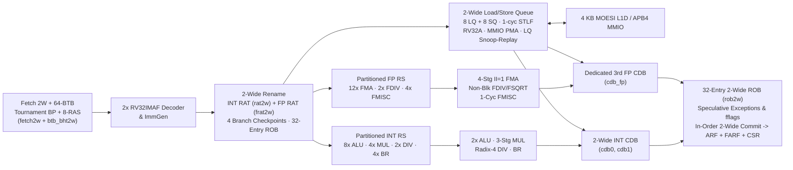

# ISA, Privilege Architecture & 2-Wide Out-of-Order Core Reference Manual

**Document ID:** `SOC-REF-01`
**Target Core:** `ooo2w_core` (`RV32IMAF_Zicsr_Zifencei`)
**Applies To:** `single_ooo2w_soc` (1 Hart) & `dual_ooo2w_soc` (2 Harts, Peak 4.0 Instructions/Cycle)

---

## 1. Instruction Set Architecture (`RV32IMAF_Zicsr_Zifencei`)

Each hart implements the complete 32-bit Little-Endian RISC-V **`RV32IMAF_Zicsr_Zifencei`** user & Machine-mode ISA (`misa = 0x4000_1121` when `MISA_EXT_F = 1`, encoding `MXL=1 [32-bit]` + extensions `I`, `M`, `A`, `F`).

| Extension | Instructions Implemented | Execution Unit & Latency |
| :--- | :--- | :--- |
| **`RV32I`** | Integer ALU (`ADD/SUB/SLL/SLT/SLTU/XOR/SRL/SRA/OR/AND` + `*I`), `LUI`, `AUIPC`, Branches (`BEQ/BNE/BLT/BGE/BLTU/BGEU`), `JAL`, `JALR`, Loads (`LB/LH/LW/LBU/LHU`), Stores (`SB/SH/SW`), `FENCE` | Dual 1-cycle ALUs (`alu.v`), 1-cycle `branch_comp.v`, 2-wide `lsq2w.sv` (1-cyc L1D hit / 1-cyc STLF) |
| **`RV32M`** | `MUL`, `MULH`, `MULHSU`, `MULHU`, `DIV`, `DIVU`, `REM`, `REMU` | 3-stage pipelined `mul_unit.sv` (`II=1`); non-blocking radix-4 early-out `div_unit.sv` |
| **`RV32A`** | `LR.W`, `SC.W`, `AMOSWAP.W`, `AMOADD.W`, `AMOXOR.W`, `AMOAND.W`, `AMOOR.W`, `AMOMIN.W`, `AMOMAX.W`, `AMOMINU.W`, `AMOMAXU.W` | Executed atomically at ROB head inside coherent L1D (`dcache_nb_coh.sv`) with 16 B line-granule reservation |
| **`RV32F`** | `FLW`, `FSW`, `FMADD.S`, `FMSUB.S`, `FNMSUB.S`, `FNMADD.S`, `FADD.S`, `FSUB.S`, `FMUL.S`, `FDIV.S`, `FSQRT.S`, `FSGNJ/N/X.S`, `FMIN.S`, `FMAX.S`, `FEQ.S`, `FLT.S`, `FLE.S`, `FCLASS.S`, `FCVT.W/WU.S`, `FCVT.S.W/WU`, `FMV.X.W`, `FMV.W.X` | 4-stage `II=1` `fpu_fma_pipe.sv`; non-blocking radix-2 `fpu_div_sqrt.sv` (~28 cyc); 1-cycle `fpu_misc.sv`; `lsq2w.sv` |
| **`Zicsr`** | `CSRRW`, `CSRRS`, `CSRRC`, `CSRRWI`, `CSRRSI`, `CSRRCI` | Non-speculative ROB-head execution in `csr_unit.sv` |
| **`Zifencei`** | `FENCE.I` | Triggers dirty L1D clean-all sweep (`M→E`, `O→S` via WBB→L2), L1I invalidate-all & pipeline redirect |
| **Privileged (M-Mode)** | `ECALL`, `EBREAK`, `MRET` | Precise ROB-head trap entry & return (`rob2w.sv` + `csr_unit.sv`) |

### Architectural Register Files
- **Integer Register File (`regfile2w.sv`)**: `32 × 32-bit` (`x0` hardwired `0`; `x1`–`x31` RW), 4R2W ports.
- **Floating-Point Register File (`fregfile2w.sv`)**: `32 × 32-bit` (`f0`–`f31`, **`f0` is writable** per RISC-V F spec), 6R2W ports supporting 3-operand FMA (`rs1, rs2, rs3`) across dual dispatch slots with zero integer port contention.

---

## 2. Machine-Mode Privilege, Trap & CSR Reference (`csr_unit.sv`)

All harts execute in **Machine Mode (M-mode)** (`mstatus.MPP` hardwired to `2'b11`).

### 2.1 Supported Control and Status Registers (CSRs)

| Address | Name | Access | Reset Value | Bitfields & Semantics |
| :---: | :--- | :---: | :---: | :--- |
| `0x001` | `fflags` | RW* | `0x0000_0000` | `[4] NV` Invalid Op, `[3] DZ` Div-by-Zero, `[2] OF` Overflow, `[1] UF` Underflow, `[0] NX` Inexact |
| `0x002` | `frm` | RW* | `0x0000_0000` | `[2:0]` Dynamic FP rounding mode (`0=RNE, 1=RTZ, 2=RDN, 3=RUP, 4=RMM`; `5..7` reserved → illegal on dynamic use) |
| `0x003` | `fcsr` | RW* | `0x0000_0000` | `[7:5] frm`, `[4:0] fflags`, `[31:8]` hardwired `0` |
| `0x300` | `mstatus` | RW | `0x0000_3800` | `[14:13] FS` (`00`=Off, `01`=Initial [reset], `10`=Clean, `11`=Dirty), `[12:11] MPP` (`11` RO), `[7] MPIE`, `[3] MIE` |
| `0x301` | `misa` | RW-WARL | `0x4000_1121` | `[31:30]=01` (RV32), `[12]=M`, `[8]=I`, `[5]=F` (`MISA_EXT_F=1`), `[0]=A`; writes ignored |
| `0x304` | `mie` | RW | `0x0000_0000` | `[11] MEIE` (PLIC External), `[7] MTIE` (CLINT Timer), `[3] MSIE` (CLINT Software/IPI) |
| `0x305` | `mtvec` | RW | `0x0000_0000` | `[31:2] BASE` (4 B aligned; 256 B aligned recommended for Vectored), `[1:0] MODE` (`00`=Direct, `01`=Vectored; `10/11` masked to `00`) |
| `0x340` | `mscratch` | RW | `0x0000_0000` | 32-bit per-hart M-mode scratchpad register |
| `0x341` | `mepc` | RW | `0x0000_0000` | Exception PC (`[1:0]` hardwired `2'b00` for IALIGN=32) |
| `0x342` | `mcause` | RW | `0x0000_0000` | `[31] Interrupt` (`1`=async IRQ, `0`=sync exception), `[3:0] Exception Code` |
| `0x343` | `mtval` | RW | `0x0000_0000` | Faulting virtual/physical address (`mcause=0,4,5,6,7`) or raw 32-bit faulting instruction (`mcause=2`); `0` for `ECALL`/IRQs |
| `0x344` | `mip` | RO-WARL | Live HW | `[11] MEIP` (from PLIC), `[7] MTIP` (from CLINT), `[3] MSIP` (from CLINT); cleared at peripheral source |
| `0xB00` / `0xB80` | `mcycle` / `mcycleh` | RW | `0` | 64-bit live core clock cycle counter (freezes when `halted=1`) |
| `0xB02` / `0xB82` | `minstret` / `minstreth` | RW | `0` | 64-bit live retired-instruction counter (increments by `0`, `1`, or `2` per cycle) |
| `0xC00` / `0xC80` | `cycle` / `cycleh` | RO | Live | Read-only shadow of `mcycle` / `mcycleh` (writes raise `mcause=2`) |
| `0xC02` / `0xC82` | `instret` / `instreth` | RO | Live | Read-only shadow of `minstret` / `minstreth` (writes raise `mcause=2`) |
| `0xF11` | `mvendorid` | RO | `0x0000_0000` | Non-commercial open implementation |
| `0xF12` | `marchid` | RO | `0x0000_2002` | Dual-Core 2-Wide OoO Architecture ID |
| `0xF13` | `mimpid` | RO | `0x0001_0000` | Implementation Revision 1.0 |
| `0xF14` | `mhartid` | RO | `CORE_ID` | Hart ID (`0` on Core 0, `1` on Core 1) |

> **Note (`*` FP CSR Access Rules & Pipeline Sync):** Accessing `fflags`, `frm`, `fcsr`, or any `RV32F` instruction while `mstatus.FS == 2'b00` (Off) raises an **Illegal Instruction** exception (`mcause = 2`). Writing `mstatus`, `frm`, or `fcsr` sets `csr_sync_required = 1`, flushing younger speculative instructions at commit so they re-decode with the exact updated `mstatus.FS` and `frm`. Any FP instruction retiring a result into `f0`–`f31` or any explicit write to `fflags`/`frm`/`fcsr` automatically transitions `mstatus.FS → 2'b11` (Dirty).

### 2.2 Precise Exception & Interrupt Causes (`mcause`)

| `mcause[31]` | Code | Cause Name | `mtval` Value | Trigger Condition |
| :---: | :---: | :--- | :--- | :--- |
| `0` | `0` | Instruction Address Misaligned | Faulting target PC | Taken branch, `JAL`, or `JALR` target with `target[1:0] != 2'b00` |
| `0` | `2` | Illegal Instruction | Raw 32-bit instruction | Invalid opcode/funct3/funct7, illegal/RO CSR write, `RV32F`/FCSR with `FS==0`, invalid FP `rm` (`5`/`6`, or `7` with `frm>=5`) |
| `0` | `3` | Breakpoint | Faulting PC | `EBREAK` when `mtvec != 0` (**Note:** when `mtvec == 0`, `EBREAK` cleanly halts the hart for legacy bare-metal tests) |
| `0` | `4` | Load Address Misaligned | Faulting byte address | `LH`/`LHU` with `addr[0]!=0`; `LW`/`FLW`/`LR.W` with `addr[1:0]!=0` |
| `0` | `5` | Load Access Fault | Faulting byte address | Unmapped address or APB4 `PSLVERR=1` on load |
| `0` | `6` | Store/AMO Address Misaligned | Faulting byte address | `SH` with `addr[0]!=0`; `SW`/`FSW`/`SC.W`/`AMO*.W` with `addr[1:0]!=0` |
| `0` | `7` | Store/AMO Access Fault | Faulting byte address | Unmapped address or APB4 `PSLVERR=1` on store (e.g., RO register write) |
| `0` | `11` | Environment Call from M-Mode | `0x0000_0000` | `ECALL` instruction |
| `1` | `3` | Machine Software Interrupt (`MSI`) | `0x0000_0000` | `mstatus.MIE && mie.MSIE && clint_msip` |
| `1` | `7` | Machine Timer Interrupt (`MTI`) | `0x0000_0000` | `mstatus.MIE && mie.MTIE && clint_mtip` |
| `1` | `11` | Machine External Interrupt (`MEI`) | `0x0000_0000` | `mstatus.MIE && mie.MEIE && plic_meip` |

### 2.3 Trap Entry, Interrupt Priority & `MRET` Semantics
1. **Priority:** Synchronous exceptions at ROB head are evaluated on the retiring instruction; asynchronous interrupts are sampled cleanly at ROB-head boundaries with fixed RISC-V priority **`MEI (11) > MSI (3) > MTI (7)`**.
2. **Atomic Trap Entry:**
   - All older stores in the Store Queue drain cleanly before entering the trap handler; all younger speculative instructions (including any younger speculative faults or stores) are flushed.
   - `mepc <= {trap_pc[31:2], 2'b00}`, `mcause <= {is_irq, 27'd0, code[3:0]}`, `mtval <= trap_tval`.
   - `mstatus.MPIE <= mstatus.MIE`; `mstatus.MIE <= 1'b0`.
   - Next PC = `(mtvec[1:0] == 2'b01 && is_irq) ? ({mtvec[31:2], 2'b00} + (code << 2)) : {mtvec[31:2], 2'b00}` (Direct vs. Vectored).
3. **`MRET` Execution:** Restores `mstatus.MIE <= mstatus.MPIE`, sets `mstatus.MPIE <= 1'b1`, flushes speculative younger instructions, and redirects Fetch to `mepc`.

---

## 3. IEEE-754-2008 Single-Precision FPU Architecture (`rtl/fpu/`)

The FPU implements full IEEE-754-2008 `binary32` compliance (including subnormals, tininess-after-rounding underflow detection, signed zeros, infinities, signaling/quiet NaNs, and RISC-V canonical qNaN `0x7FC0_0000` propagation):

| Unit | RTL File | Pipeline / Latency | Architecture Details |
| :--- | :--- | :---: | :--- |
| **FMA / Add / Sub / Mul** | `rtl/fpu/fpu_fma_pipe.sv` | **4 stages, `II = 1`** (1 FMA/cycle) | True single-rounding fused multiply-add with 74-bit aligned significand datapath, leading-zero anticipation/normalization, subnormal support, and exact sticky bit. `FADD`/`FSUB` steer `a * 1.0 ± b`; `FMUL` steers `a * b + (±0.0)` so all 7 arithmetic ops share one deeply pipelined datapath. Supports ROB branch-squash kill on every stage. |
| **Div / Sqrt** | `rtl/fpu/fpu_div_sqrt.sv` | **Non-blocking iterative** (~28 cyc) | Radix-2 restoring divider (`FDIV.S`) and digit-recurrence square root (`FSQRT.S`) with subnormal pre-normalization, exact remainder sticky bit, all 5 rounding modes, exact `fflags`, early special-case bypass (0/Inf/NaN), and ROB squash cancellation. |
| **Misc / Cmp / Convert** | `rtl/fpu/fpu_misc.sv` | **1 cycle** | `FSGNJ/N/X.S`, IEEE-754-2008 `FMIN.S`/`FMAX.S` (signed-zero & NaN number-favoring), `FEQ`/`FLT`/`FLE.S`, 10-bit `FCLASS.S`, exact saturating `FCVT.W/WU.S`, `FCVT.S.W/WU`, raw bitwise `FMV.X.W` / `FMV.W.X`. |

- **Standalone Verification (`scripts/test_phase_u5_fpu.py`):** Verified bit-for-bit (32-bit result + all 5 `fflags`) across **58,209 Verilator vectors**, **6,041 Icarus vectors**, and **32,050 host `fenv.h`/`libm` cross-check vectors** against our exact rational-arithmetic Python oracle (`scripts/ieee754_oracle.py`) — **0 result mismatches and 0 `fflags` mismatches**.

---

## 4. 2-Wide Out-of-Order Core Microarchitecture (`ooo2w_core.sv`)

### Non-Blocking Superscalar Design Pillars
1. **Zero-Stall Speculative Exceptions & `fflags`:** Illegal instructions, misaligned targets, misaligned loads/stores, bus faults, and per-instruction 5-bit FP `fflags` travel inside ROB entries (`rob2w.sv`). Mispredicted branch squashes discard speculative faults and speculative `fflags` completely; non-faulting code retires at up to **2 instructions/cycle per core (4.0 chip peak)**.
2. **True Parallel INT + FP Execution:** Independent FP rename (`frat2w.sv`), 6R2W FP regfile (`fregfile2w.sv`), 12-entry 3-source FMA RS (`rs_fpu2w.sv`), and a **dedicated 3rd CDB (`cdb_fp`)** allow integer loop induction, `FLW`/`FSW` memory streams, `FMADD.S` pipelines, and `FDIV.S` iterations to overlap simultaneously (delivering **`3.286` aggregate chip IPC** on `32×32` compiled GCC float SGEMM).
3. **2-Wide Load/Store Dispatch (`lsq2w.sv`):** Dispatches any 2-wide combination (`LD+LD`, `ST+ST`, `LD+ST`, `ST+LD`) per cycle into an 8-entry LQ + 8-entry SQ, supporting 1-cycle word/sub-word Store-to-Load Forwarding (STLF) across both `LW`/`SW` and `FLW`/`FSW`.
4. **RVWMO Speculative Load Snoop-Replay:** Whenever `dcache_nb_coh` receives a `GetM`/`Upgrade` invalidation (from the peer core OR from the Coherent DMA engine!), it pulses `snoop_inv_valid` + `snoop_inv_laddr` into `lsq2w.sv`. Any completed speculative load in the LQ matching that cache line is poisoned and triggers a precise replay flush at ROB head (with ROB-head exemption for unpoisoned loads preventing false-sharing livelock).
5. **Measured Core Area (`synth_audit.py`):** One complete `ooo2w_core` (`RV32IMAF_Zicsr_Zifencei`, 26 sub-units) synthesizes to **411,042 ABC standard cells** and **30,266 flip-flops** with **0 inferred latches** and **0 combinational loops** (`scc -expect 0`).
