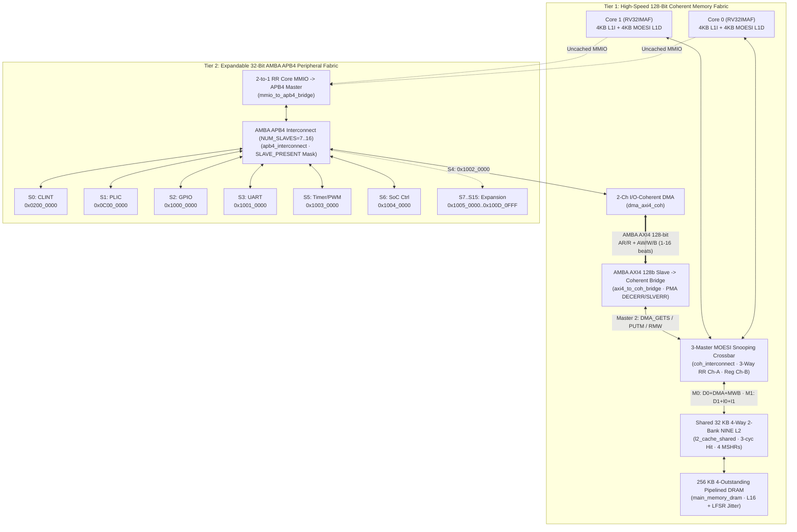
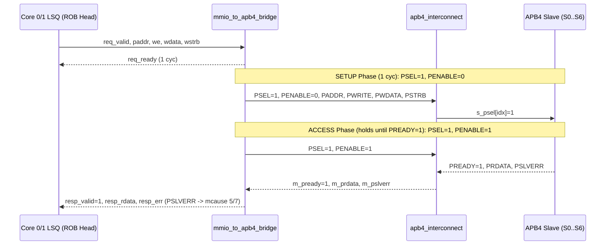

> **Disclaimer:** This project and documentation were developed using **Gemini 4 Neon**.

# SoC Physical Memory Map, AMBA Bus Architecture & 3-Master MOESI Coherence Specification

**Document ID:** `SOC-REF-02`
**Applies To:** `dual_ooo2w_soc` (2 Cores + AMBA AXI4 Coherent DMA + AMBA APB4) & `single_ooo2w_soc` (1 Core + AMBA APB4)
**Single Source of Truth:** [`rtl/soc/soc_addr_map.vh`](../rtl/soc/soc_addr_map.vh) & [`sw/hal/soc_regs.h`](../sw/hal/soc_regs.h)

---

## 1. Unified 32-Bit Physical Address Map & PMA Rules

Every core's LSQ (`lsq2w.sv`) evaluates a full 32-bit physical address (`paddr[31:0]`) against the hardware **Physical Memory Attribute (PMA)** decoder:
- **Cacheable Coherent RAM (`paddr < SOC_RAM_SIZE = 0x0004_0000`)**: Routed to private MOESI L1D (`dcache_nb_coh.sv`), supporting speculative loads, 1-cycle STLF, MSHR hit-under-miss, RV32A atomics, and hardware cache coherence with both cores and the AXI4 DMA engine.
- **Uncached Strongly-Ordered I/O (`paddr >= 0x0004_0000`)**: Routed strictly non-speculatively at ROB head (after all older stores drain from SQ) through the 2-to-1 round-robin `mmio_to_apb4_bridge.sv` → `apb4_interconnect.sv`. Any unmapped hole, unpopulated expansion slot, or illegal RO/busy write asserts `PSLVERR=1`, returning a precise **Load Access Fault (`mcause=5`)** or **Store Access Fault (`mcause=7`)** with `mtval = paddr`.

| Base Address | End Address | Size | Slot | PMA / Bus Tier | Target Peripheral / Region |
| :--- | :--- | :---: | :---: | :--- | :--- |
| `0x0000_0000` | `0x0003_FFFF` | 256 KB | — | Cacheable, Coherent (MOESI L1/L2 + AXI4 DMA) | Unified Main RAM (`.text`, `.rodata`, `.data`, `.bss`, 16 KB/core stacks) |
| `0x0200_0000` | `0x0200_FFFF` | 64 KB | `S0` | Uncached Strongly-Ordered (AMBA APB4) | **CLINT** (`msip0/1`, 64-bit `mtime`, `mtimecmp0/1`, `scratch[0..3]`) |
| `0x0C00_0000` | `0x0C20_FFFF` | ~2.1 MB | `S1` | Uncached Strongly-Ordered (AMBA APB4) | **PLIC** (16 IRQ sources, 3-bit prio, 2 M-mode contexts, Claim/Complete) |
| `0x1000_0000` | `0x1000_0FFF` | 4 KB | `S2` | Uncached Strongly-Ordered (AMBA APB4) | **32-Pin GPIO** (`DATA_IN/OUT`, `DIR`, atomic `SET/CLR/TGL`, pin IRQs) |
| `0x1001_0000` | `0x1001_0FFF` | 4 KB | `S3` | Uncached Strongly-Ordered (AMBA APB4) | **16-FIFO 8N1 UART** (TX/RX FIFOs, baud, loopback, fast-sim, IRQs) |
| `0x1002_0000` | `0x1002_0FFF` | 4 KB | `S4` | Uncached Strongly-Ordered (AMBA APB4) | **2-Ch Coherent DMA Control** (populated on `dual_ooo2w_soc`; `PSLVERR` on 1C) |
| `0x1003_0000` | `0x1003_0FFF` | 4 KB | `S5` | Uncached Strongly-Ordered (AMBA APB4) | **2-Ch 32-Bit Timer / PWM** (prescaler, period, compare, one-shot/periodic) |
| `0x1004_0000` | `0x1004_0FFF` | 4 KB | `S6` | Uncached Strongly-Ordered (AMBA APB4) | **SoC Control & Live PMU** (`SOC_ID`, `FEATURES`, `TOHOST/HALT`, live PMUs) |
| `0x1005_0000` | `0x100D_0FFF` | 9 × 4 KB | `S7`–`S15` | Reserved APB4 Expansion Slots | Plug-and-play expansion (`0x1005_0000 + (slot-7)*0x10000`; `PSLVERR=1` until populated) |
| All other addresses | — | — | — | Unmapped (`PSLVERR = 1`) | Precise Load (`mcause=5`) / Store (`mcause=7`) Access Fault |

---

## 2. Dual-Tier Expandable AMBA SoC Bus Architecture



---

## 3. Tier 2 Specification: AMBA APB4 Peripheral Fabric

Implemented in [`rtl/bus/mmio_to_apb4_bridge.sv`](../rtl/bus/mmio_to_apb4_bridge.sv) and [`rtl/bus/apb4_interconnect.sv`](../rtl/bus/apb4_interconnect.sv) in full compliance with **ARM IHI 0024C (AMBA APB4)**:

### 3.1 Signal & Protocol Rules
- **Master Signals:** `PADDR[31:0]`, `PSEL`, `PENABLE`, `PWRITE`, `PWDATA[31:0]`, `PSTRB[3:0]`.
- **Slave Return Signals:** `PREADY`, `PRDATA[31:0]`, `PSLVERR`.
- **2-Phase FSM (`mmio_to_apb4_bridge`):**
  1. `ST_IDLE`: Fair 2-to-1 round-robin arbitration between Core 0 and Core 1 MMIO ports.
  2. `ST_SETUP` (1 cycle): Asserts `PSEL=1, PENABLE=0` with registered `PADDR`, `PWRITE`, `PWDATA`, and `PSTRB` (forced to `4'b0000` on reads per APB4 §3.1.1).
  3. `ST_ACCESS` (≥1 cycle): Asserts `PSEL=1, PENABLE=1`, holding all address/write signals completely stable until `PREADY=1`. Samples `PRDATA` and `PSLVERR`, then delivers a 1-cycle registered response (`resp_valid`, `resp_rdata`, `resp_err`) to the originating core.



---

## 4. Tier 1 Specification: AMBA AXI4 Coherent DMA Protocol

Implemented in [`rtl/periph/dma_axi4_coh.sv`](../rtl/periph/dma_axi4_coh.sv) (Master) and [`rtl/bus/axi4_to_coh_bridge.sv`](../rtl/bus/axi4_to_coh_bridge.sv) (Slave → MOESI Master 2):

- **Data Width:** 128-bit (`AWSIZE = ARSIZE = 3'b100`, 16 bytes/beat, matching the uniform 16 B cache line across L1, L2, and DRAM).
- **Burst Type & Length:** `INCR` (`2'b01`), configurable `1`–`16` beats (`ARLEN/AWLEN = 0..15`, up to 256 bytes/burst).
- **4 KB Burst-Boundary Compliance (AXI4 §A3.4.1):** `dma_axi4_coh` dynamically clamps every read and write burst chunk so no single AXI4 burst ever crosses a `0x1000` (4 KB) page boundary, even on arbitrary unaligned byte transfers.
- **Unaligned Byte-Granular Support:** A compact 16×128-bit burst buffer and 256-to-128-bit byte-alignment barrel shifter align arbitrary `SRC[3:0]` → `DST[3:0]` byte offsets and generate exact 16-bit `WSTRB[15:0]` edge masks (`DMA_RMW` on partial head/tail lines, `DMA_PUTM` on full middle lines).
- **PMA Bus-Error Enforcement (`axi4_to_coh_bridge`):**
  - Any beat with `addr >= 32'h0004_0000` completes the AXI4 protocol handshake cleanly with `RRESP/BRESP = 2'b11` (**`DECERR`**) without issuing any coherence or L2 transaction.
  - Unsupported burst type (`!= INCR` with `len > 0`) or beat size (`!= 16 B`) returns `2'b10` (**`SLVERR`**).
  - Legal `WSTRB == 16'h0000` write beats are acknowledged cleanly as zero-byte no-ops.

---

## 5. 3-Master MOESI I/O-Coherence Protocol (`coh_interconnect.sv` + `dcache_nb_coh.sv`)

### 5.1 Stable States & Split-Transaction Channels
- **5 Stable MOESI States (`coh_defs.vh`):** `I` (Invalid), `S` (Shared clean), `E` (Exclusive clean — enables silent `E→M` store upgrade with 0 bus traffic), `O` (Owned dirty — serves dirty C2C reads with 0 L2 writeback when `ENABLE_MOESI_O=1`; disabled in `ENABLE_MOESI_O=0` MESI ablation mode), `M` (Modified dirty).
- **4 Deadlock-Free Logical Channels:**
  - **Channel A (Ordered Request):** Fair 3-way round-robin across `{D0, D1, DMA}` (`rr_chan_a`) gated by an exact address-hazard table covering all in-flight L2 reads (`p_v[3:0]`, `p_dma_v`), C2C buffers (`c2c0/1`), MESI-WB (`mwb_v`), and DMA writeback (`dma_wb_v`). Requests to *different* cache lines pipeline freely!
  - **Channel B (Registered Snoop Probe):** 1-cycle registered boundary guaranteeing **zero cross-core combinational loops**. Core 0 snoops D1; Core 1 snoops D0; **Coherent DMA broadcasts to BOTH D0 and D1 simultaneously**.
  - **Channel C (Snoop Response / C2C / Dirty WBB):** Combinational snoop reply from duplicate snoop tag arrays + 2-entry snoopable WBBs (`SNP_RESP_MISS`, `SHARED`, `INVACK`, `DATA`), plus dedicated WBB writeback streams to L2 Master 0 (D0) & Master 1 (D1).
  - **Channel D (Lossless Data / Upgrade-ACK Return):** Priority L2 response + lossless 1-entry C2C/Upgrade buffer per core.

### 5.2 I/O-Coherent DMA State Transition Matrix

| DMA Operation | Broadcast Snoop (Both D0 & D1) | Action if Core Holds `M`/`O`/WBB | Action if Core Holds `E`/`S` | Action if Both `I` | Effect on `lsq2w` |
| :--- | :---: | :--- | :--- | :--- | :--- |
| **`DMA_GETS`** (Read Beat) | `COH_REQ_GETS` | Pulls 128 b dirty data via C2C (`M→O` in MOESI; `M→S` + `mwb_v` WB in MESI); **0 L2 read!** | `E→S`, `S→S`; reads Shared L2 (`L2ID_DMA=2`) | Reads Shared L2 (`L2ID_DMA=2`) | None |
| **`DMA_PUTM`** (Full-Line Write, `wstrb=0xFFFF`) | `COH_REQ_GETM` | Invalidates `M`/`O→I`, cancels matching WBB, writes 128 b DMA line directly to L2 via `dma_wb_v` | Invalidates `E`/`S→I`; writes 128 b DMA line to L2 | Writes 128 b DMA line to L2 | Pulses `snoop_inv_valid` to both cores (automatic LQ replay!) + clears LR/SC reservations |
| **`DMA_RMW`** (Partial Write, `0 < wstrb < 0xFFFF`) | `COH_REQ_GETM` | Pulls dirty C2C line, invalidates `M`/`O→I` & cancels WBB, byte-merges `wstrb`, writes merged 128 b line to L2 | Invalidates `E`/`S→I`, reads Shared L2 (`p_dma_rmw=1`), byte-merges `wstrb`, writes merged line to L2 | Reads Shared L2, byte-merges `wstrb`, writes merged line to L2 | Pulses `snoop_inv_valid` to both cores + clears LR/SC reservations + holds `p_dma_la` hazard lock |

> **Formal Verification Guarantee:** Both 2-master ([`tb/formal/coh_formal.sby`](../tb/formal/coh_formal.sby)) and 3-master Core0+Core1+DMA ([`tb/formal/coh_formal_dma.sby`](../tb/formal/coh_formal_dma.sby)) configurations are **formally proved unbounded ($t \to \infty$) via SymbiYosys `abc pdr`** for 3-way SWMR & Unique Dirty Owner, plus **depth-14 `abc bmc3`** for exact Golden Shadow Data-Value consistency across `D0 + D1 + WBB0/1 + C2C0/1 + DMA_GETS/PUTM/RMW + DMA_WB + L2`.

---

## 6. How to Add a New Plug-and-Play APB4 Peripheral (Zero Core/Cache Changes!)

Adding a new peripheral (e.g., an SPI Master in expansion slot `S7` @ `0x1005_0000`, PLIC Source `8`) requires **only 4 local edits**:

1. **Create your APB4 slave RTL** (`rtl/periph/apb4_spi.sv`) exposing the standard 10-wire APB4 slave port (`psel, penable, pwrite, paddr, pwdata, pstrb, pready, prdata, pslverr`) + optional `irq_out`.
2. **Name the slot in [`rtl/soc/soc_addr_map.vh`](../rtl/soc/soc_addr_map.vh)** (note: `apb4_interconnect.sv` *already* decodes slots `S7..S15` at `0x1005_0000 .. 0x100D_0FFF` automatically!):
   ```systemverilog
   localparam integer APB_SLV_SPI  = 7;
   localparam [31:0]  SOC_SPI_BASE = 32'h1005_0000;
   ```
3. **Wire it into [`rtl/soc/dual_ooo2w_soc.sv`](../rtl/soc/dual_ooo2w_soc.sv)**:
   - Bump `APB_NUM_SLAVES = 8` and set bit `7` in `APB_SLV_MASK = 16'b0000_0000_1111_1111`.
   - Instantiate `apb4_spi u_spi (...)` connected to `apb_s_psel[APB_SLV_SPI]`, `apb_s_pready[APB_SLV_SPI]`, `apb_s_prdata[APB_SLV_SPI*32 +: 32]`, `apb_s_pslverr[APB_SLV_SPI]`.
   - Connect `spi_irq` into bit `8` of `plic_irq_src[15:1]`.
4. **Add C HAL defines in `sw/hal/soc_regs.h` & `sw/hal/hal_spi.h`** (`#define SOC_SPI_BASE 0x10050000u`, `#define PLIC_IRQ_SPI 8u`).

No edits to `ooo2w_core`, `lsq2w`, `dcache_nb_coh`, `coh_interconnect`, `l2_cache_shared`, or `apb4_interconnect` are needed!
